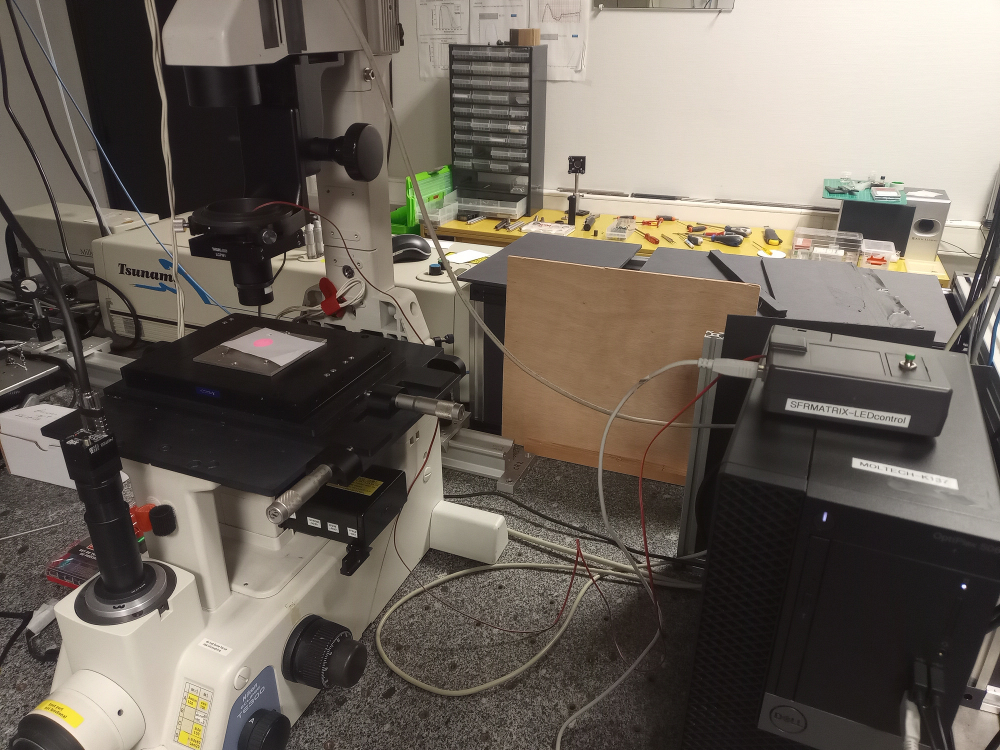
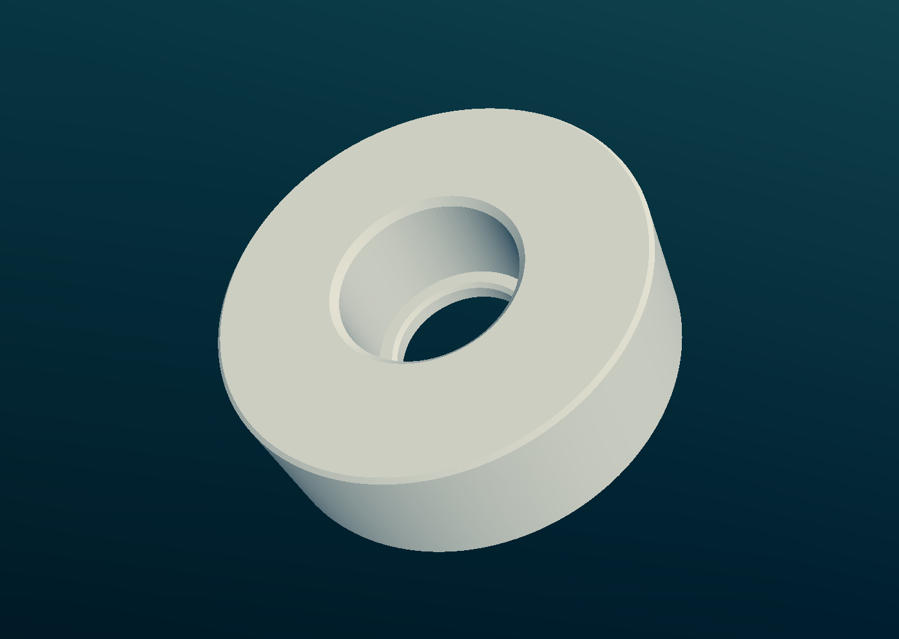
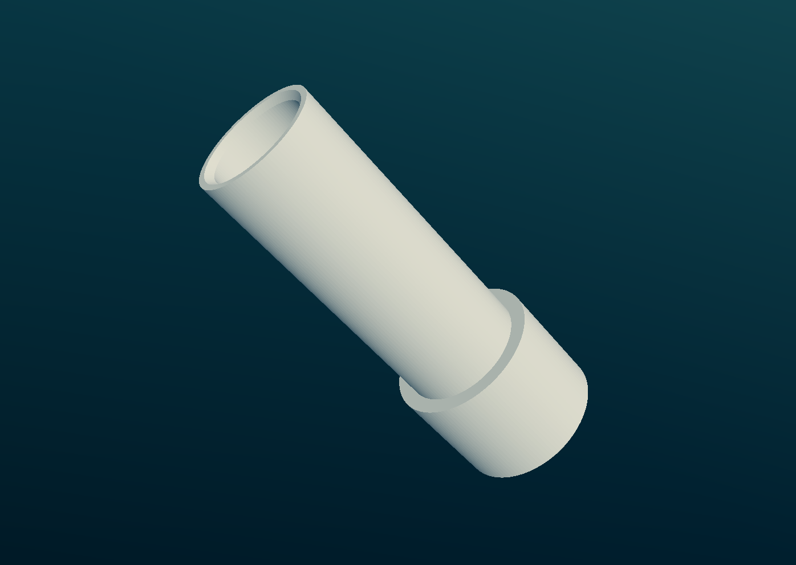
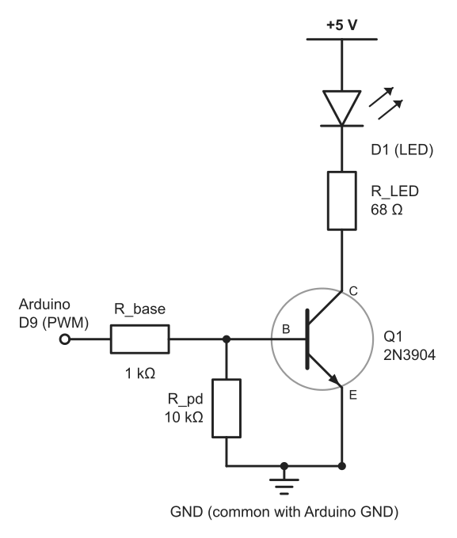
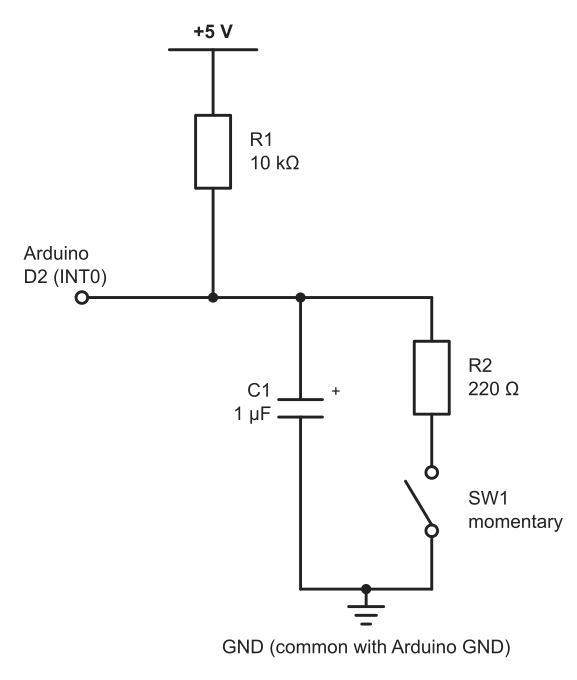

# SFRMATRIX-LED-light: electronically controlled LED illumination for optical microscopy

Christophe Cassagne, Martinus H. V. Werts

*LPhiA & MOLTECH-Anjou, SFR MATRIX, Université d'Angers, France*

Coding, electronics design choices and writing of documentation in this project were assisted by mistral.ai and claude.ai. Everything was checked, built and tested by humans, who are now happily using the end result in their scientific work.


## Description

A simple and compact LED illuminator has been developed for bright-field transmitted light optical microscopy. It consists of 3D-printed mechanical parts that hold the LED and can be mounted on a Thorlabs condenser adapter. The latter is mounted directly on the condenser holder (instead of the original condenser assembly of the microscope). The LED assembly includes a simple lens that acts as a condenser of the LED light. This gives a very compact illuminator, not needing the bulky incandescent original light source and power supply. The LEDs used are of the low-power 5 mm and 3 mm varieties, and provide ample light for basic transmitted light microscopy. The emission wavelength can be chosen to best fit the set-up. We chose 660 nm (Osram SFH 464) and 880 nm (Osram SFH 487) LEDs.

<div align="center">
    
</div>

At the left of the photo, we see, on the sample stage of our inverted microscope, the red light spot projected onto the white card by the LED illuminator assembly. A pair of wires comes out of the top of the illuminator and is connected to the "SFRMATRIX-LEDcontrol" electronic box at the right of the photo, on top of the PC workstation. The electronics box is based on an Arduino Uno R3 microcontroller board, with a custom LED driver and electronics for a control push button. The box can operate autonomously or be controlled, via USB, by a host PC workstation.


## LED holder hardware for Thorlabs SM30 tube

The LED holder is composed of two parts: an adapter ring that goes into the Thorlabs SM30 tube, and an LED carrier tube that fits in the adapter ring.

<div align="center">
    
</div>

The adapter ring is `bague_portediode`. The LED carrier exists in versions for 3 mm, 4 mm and 5 mm LEDs (`sup_diode3mm`, `sup_diode4mm`, `sup_diode5mm`). Print the `.stl` files; the `.ipt` files are the Autodesk Inventor sources, in case you need to modify the design.

## LED controller electronics box

The electronics box is based on an Arduino Uno R3 microcontroller board with additional electronics:

- LED drive electronics for PWM LED drive via Arduino pin 9
- Push button electronics via Arduino pin 2


### LED drive electronics

The LED driver is a 'low-side switch' circuit around an NPN transistor, 2N3904, which, compared to the venerable BC547B, can handle more current (up to 200 mA). The switch is controlled using Arduino pin 9, which has extensive hardware PWM capabilities.

<div align="center">
    
</div>

#### Approximate currents in the circuit

**Nota bene!** The device is configured for relatively high currents. Verify that your LEDs support these, else change R_LED accordingly. The LED currents below are those at full brightness (PWM level 255, "Max" in the control GUI).

- I_LED = (5 V − Vf − 0.2 V) / 68 Ω
    - Typical red LED (Vf ≈ 2 V): ≈ 41 mA
    - Typical white/blue LEDs (Vf ≈ 3.2 V): ≈ 23 mA
- I_base ≈ (5 V − 0.7 V) / 1 kΩ ≈ 4 mA
- R_pd keeps Q1 switched off while D9 floats.


#### Our choice of LEDs

We have been using the driver electronics successfully with the following LEDs:

- Osram SFH 464 E7800, GaAlAs (660 nm), rated max. 50 mA continuous, Vf = 2.1 V min.
- Osram SFH 487, GaAlAs (880 nm), rated max. 100 mA continuous, Vf = 1.5 V min.
- generic 5 mm white LED, works fine even at 100% power.

Both Osram LEDs can withstand higher pulsed currents when in PWM operation.


### Push button electronics (momentary switch)

<div align="center">
    
</div>

Hardware debounce via R1/C1. Current limiting R2 is intended to reduce spark-induced wear on the momentary switch (push button). Arduino pin 2 input enables triggering interrupts on the Arduino. (The main firmware simply polls the pin; the test sketch below uses an interrupt.)


### Parts list

| Ref. | Value | Function |
|---|---|---|
| Q1 | 2N3904 (NPN) | LED low-side switch |
| R_base | 1 kΩ | Base resistor, between pin 9 and the base of Q1 |
| R_pd | 10 kΩ | Pull-down on the base of Q1 |
| R_LED | 68 Ω | LED current limiting |
| D1 | 3 mm or 5 mm LED | Illumination LED |
| R1 | 10 kΩ | Pull-up of the push button circuit |
| C1 | 1 µF (if tantalum: + towards the node) | Debounce capacitor |
| R2 | 220 Ω | Current limiting for the switch |
| SW1 | Momentary push button | Manual control |


## Firmware

The Arduino sketches are in `arduino_firmwares/`. Open the `.ino` file in the Arduino IDE, select the board (Arduino Uno) and port, and upload.

| Sketch | Use |
|---|---|
| `led_pwm_serial_w_button_ctrl` | **Full firmware for the electronics box**: serial control and push button. |
| `led_pwm_serial` | Serial control only, for a build without push button. |
| `momentary_switch_circuit_test` | Test of the push button circuit: prints the time and duration of each press to the serial monitor (115200 baud). |

The PWM output on pin 9 runs at about 31.4 kHz (Timer1), well above any camera frame rate or exposure time. Pin 10 shares this timer; do not combine the firmware with the Servo library or `tone()`.

### Serial commands

115200 baud, one command per line (terminated by `\n` or `\r\n`), case-insensitive:

| Command | Action |
|---|---|
| `SET <0..255>` | Set the PWM level (a bare number does the same) |
| `PCT <0..100>` | Set the level in percent |
| `GET` (or `?`) | Report the current level |
| `HELP` | List the commands |

Every command is answered by one line: `OK <level>` (the level now active) or `ERR <reason>` (level unchanged). At power-up or reset, the board prints a `READY` line first. You can try the commands with the Arduino IDE serial monitor (set the line ending to "Newline").

### Push button operation (`led_pwm_serial_w_button_ctrl`)

- **Tap** (shorter than 1 s): switches the LED off if it is on, and back to the previous level if it is off.
- **Hold** (1 s or longer): the brightness ramps while the button is held, and stays where it was on release. The ramp follows a roughly logarithmic brightness curve, takes about 8 s to cover the full range, and reverses direction on every successive hold. From the off state, the ramp goes up.

The button works with or without a host PC. The firmware does not send anything over the serial port when the button is used; a host can find out the current level with `GET`. The level set over serial is also the level restored by a tap. The timing and the brightness curve can be changed with the constants at the top of the sketch. The start-up level is 20 (about 8 %) for the button firmware and 50 (about 20 %) for the serial-only firmware.


## Control GUI (host PC)

`LED_control_gui.py` is a small control panel (slider, preset buttons) written with [NiceGUI](https://nicegui.io/). It runs on the host PC and is displayed in the web browser. The slider follows changes made with the push button on the box, because the GUI reads back the level from the board once per second.

### Installation

The GUI needs Python 3 with the packages [NiceGUI](https://nicegui.io/) and [pySerial](https://pyserial.readthedocs.io/). With [conda](https://conda-forge.org/download/) (for example Miniforge), create an environment from the provided `environment.yml`:

```
conda env create -f environment.yml
conda activate sfrmatrix-led
```

Without conda, install the packages with pip instead:

```
pip install -r requirements.txt
```


### Running

1. Upload the `led_pwm_serial_w_button_ctrl` (or `led_pwm_serial`) firmware to the Arduino, and connect it to the PC with the USB cable.
2. Close the Arduino IDE serial monitor, as only one program can use the serial port at a time.
3. Start the GUI:

```
python LED_control_gui.py
```

4. A browser page opens at <http://127.0.0.1:8080>. Select the serial port, click **Connect** and wait a few seconds (opening the port resets the Arduino), then use the slider or the preset buttons (Off, 20 %, 50 %, Max).

By default, the GUI is only reachable from the PC it runs on. To allow access from other computers on the network, change `hoststr` at the bottom of the script (be aware that the GUI then has no access control).

On Windows, `launch_LED_control.bat` is a template launcher for use with a conda environment. Edit the path of the conda installation and the environment name (`sfrmatrix-led` if you created it from `environment.yml`) before use.


